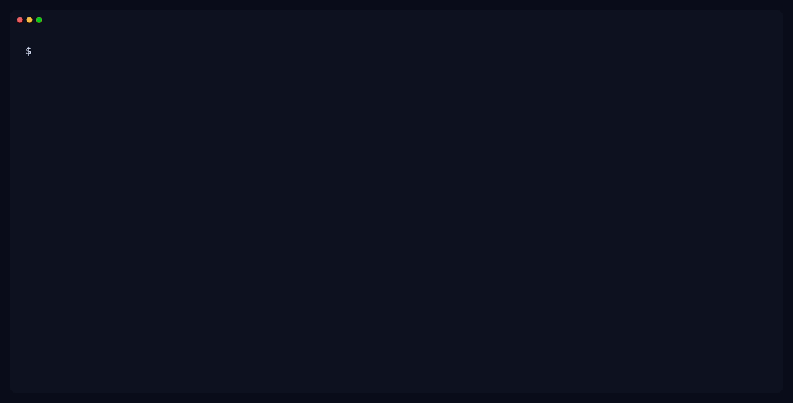

<p align="center">
  
</p>

<p align="center">
  <strong>Find end-of-life software in your repos, container images and SBOMs.</strong>
</p>

- ✅ **End-of-life** runtimes, frameworks, databases and OSes, across nearly 500 products
- ✅ **Expiring soon:** what reaches end-of-life in the next year
- ✅ **Wherever you ship from:** repos, whole GitHub, GitLab and Bitbucket orgs, container images, SBOMs
- ✅ **100+ file formats:** Dockerfiles, compose, Helm, CI configs, lockfiles, Terraform and more
- ✅ **Built for CI:** fails the build, feeds GitHub code scanning, outputs JSON
- ✅ **One binary,** no account, works offline

<p align="center">
  
</p>

## Install

```sh
go install github.com/0xbadshah/zephy/cmd/zephy@latest
```

Or download a binary for Linux, macOS or Windows from the
[latest release](https://github.com/0xbadshah/zephy/releases/latest).
[More install options.](docs/install.md)

## Use

```sh
zephy .                    # the repo you're in
zephy --org your-org       # every active repo in a GitHub org
zephy python:3.9-slim      # a container image (needs syft)
zephy --format sarif --out zephy.sarif .   # for GitHub code scanning
```

[Usage](docs/usage.md) ·
[CI](docs/ci.md) ·
[Configuration](docs/configuration.md) ·
[Supported files](docs/supported-files.md) ·
[How it works](docs/how-it-works.md)

⭐ Star the repo if zephy caught something you'd missed.

---

MIT [License](LICENSE) · Lifecycle data from
[endoflife.date](https://endoflife.date) ([MIT](internal/data/LICENSE))
